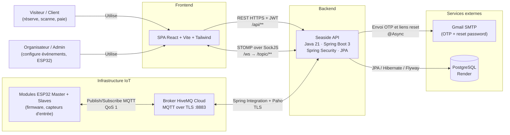

# Seaside API — Diagrammes d'architecture (C4)

> Sources Mermaid — rendus nativement sur GitHub et dans la plupart des IDE.
> Tous les diagrammes sont **alignés sur le code réel** (vérifiés fichier par fichier),
> avec la structure Feature-First de [ARCHITECTURE.md](../ARCHITECTURE.md).
>
> 📐 **Tous les diagrammes de séquence** (auth JWT/OTP, flux firmware ESP32, licence,
> dashboards temps réel) sont regroupés dans **[SEQUENCE_DIAGRAMS.md](SEQUENCE_DIAGRAMS.md)**
> — catalogue exhaustif de tous les flux du projet.

---

## 1. C4 — Niveau 1 : Contexte

Qui utilise l'API, avec quels systèmes extérieurs elle parle.



**Frontières de confiance** : le frontend est le seul client REST authentifié par JWT ;
les ESP32 ne parlent jamais REST, uniquement MQTT via le broker ; la base n'est
accessible que depuis l'API.

---

## 2. C4 — Niveau 2 : Conteneurs et composants (Vue interne de Seaside API)

Vue conteneur + composants des features. Chaque bloc = une feature verticale

```mermaid
flowchart TB
    subgraph ext["Systèmes externes"]
        frontend["SPA React<br/>JWT + SockJS"]
        broker["HiveMQ Cloud<br/>(MQTT TLS)"]
        smtp["Gmail SMTP"]
        db[("PostgreSQL")]
    end

    subgraph api["Seaside API — Spring Boot 3 (context-path /api)"]

        subgraph sec["shared/security + shared/exception"]
            sec_cfg["SecurityConfig<br/>routes publiques · CORS · BCrypt(12)"]
            jwt_filter["JwtFilter<br/>(1 requête = 1 validation)"]
            jwt_util["JwtUtil<br/>HS256 · access 1h"]
            exc["GlobalExceptionHandler"]
        end

        subgraph f_auth["feature/auth"]
            auth_web["AuthController<br/>AuthPasswordController"]
            auth_svc["AuthService · VerificationEmailService<br/>PasswordResetService · RefreshTokenService<br/>EmailService (@Async)"]
            auth_repo["Repositories OTP / RefreshToken / PasswordResetToken"]
        end

        subgraph f_user["feature/utilisateur"]
            user_web["UtilisateurController"]
            user_svc["UtilisateurService"]
            user_model["Utilisateur (UserDetails) · RoleUsers"]
        end

        subgraph f_even["feature/evenement"]
            even_web["EvenementController · CategorieController"]
            even_svc["EvenementService · CategorieService"]
            even_model["Evenement · Categorie"]
        end

        subgraph f_entree["feature/entree"]
            entree_web["EntreeController"]
            entree_svc["EntreeService"]
            entree_model["Entree · EntryCount"]
        end

        subgraph f_esp["feature/esp32"]
            esp_web["Esp32Controller"]
            esp_svc["Esp32QueryService · Esp32CommandService<br/>Esp32Service · SeasideMqttService"]
            mqtt_in["MqttConfig (inbound)<br/>adapter Paho QoS 1"]
            mqtt_router["SeasideMqttRouter"]
            mqtt_sub["SeasideMqttSubscriber"]
            mqtt_out["MqttPublisher (outbound)<br/>→ seaside/config/{mac}"]
            ws_pub["WebSocketPublisher<br/>SimpMessagingTemplate"]
            esp_model["Esp32Master · Esp32Slave<br/>BatteryTelemetry · ModuleEsp32…"]
        end

        subgraph f_lic["feature/licence — 🚧"]
            lic_model["License · LicenseStatus<br/>LicenseRepository"]
        end

        subgraph f_stats["feature/stats — 🚧 stubs"]
            stats["StatsController · StatsService"]
        end
    end

    frontend -->|REST + JWT| sec_cfg
    frontend <-->|STOMP /topic| ws_pub
    sec_cfg --> jwt_filter
    jwt_filter --> jwt_util
    jwt_filter --> user_model

    auth_web --> auth_svc
    auth_svc --> auth_repo
    auth_svc --> user_model
    auth_svc --> smtp
    auth_svc --> jwt_util

    user_web --> user_svc
    even_web --> even_svc
    entree_web --> entree_svc

    broker -->|seaside/entrees/#<br/>seaside/telemetry/#<br/>seaside/alerte| mqtt_in
    mqtt_in --> mqtt_router
    mqtt_router --> mqtt_sub
    mqtt_sub --> esp_svc
    esp_svc --> esp_model
    esp_svc --> even_model
    esp_svc --> entree_model
    esp_svc --> ws_pub
    esp_svc --> mqtt_out
    mqtt_out --> broker

    esp_model --> db
    entree_model --> db
    even_model --> db
    user_model --> db
    auth_repo --> db
    lic_model -.->|à venir| esp_model
```

(`feature/<domaine>`) ou le shared kernel.



### Chaîne MQTT réelle (code vérifié)

```
HiveMQ → MqttConfig.mqttAdapter (Paho, QoS 1)
       → mqttInputChannel (DirectChannel)
       → mqttMessageHandler → SeasideMqttRouter.router(topic, payload)
       → SeasideMqttSubscriber (parsing JSON)
       → SeasideMqttService (métier : persistance + alertes)
       → WebSocketPublisher → STOMP /topic/... → React
```

> ⚠️ **Dette connue** : les classes legacy `MqttRouter` et `MqttSubscriber`
> (`feature/esp32/mqtt/`) ne sont **plus câblées** dans `MqttConfig` — seul le chemin
> `SeasideMqttRouter` est actif. Elles peuvent être supprimées après vérification
> qu'aucun branchement ne les attend.

### Topics MQTT côté backend

| Topic | Sens | Traitement |
|---|---|---|
| `seaside/entrees/{licence}` | ESP32 → API | `traiterEntree` : master par licence → catégorie → `Entree` + WS comptage |
| `seaside/telemetry/master` | ESP32 → API | `traiterTelemetrieMaster` : maj batterie/état + alertes |
| `seaside/telemetry/slave/{n}` | ESP32 → API | `traiterTelemetrieSlave` : maj slave + `BatteryTelemetry` + alertes |
| `seaside/alerte` | ESP32 → API | `traiterAlerte` → WS alerte |
| `seaside/config/{mac}` | API → ESP32 | envoyé par `Esp32Service.envoyerConfigFirmware` |

Les payloads firmware exacts (et les écarts avec le backend) sont documentés dans
[SEQUENCE_DIAGRAMS.md](SEQUENCE_DIAGRAMS.md).

### Topics WebSocket (STOMP) consommés par React

| Topic | Contenu |
|---|---|
| `/topic/comptage/{evenementId}` | comptages par catégorie, totaux personnes/revenus |
| `/topic/telemetrie/{evenementId}` | batterie master, état des slaves, dernières activités |
| `/topic/alerte/{evenementId}` | alertes batterie / déconnexion / capacité max |
