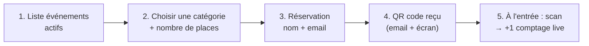

# Seaside — Briefing développeur frontend (React / Vite / Tailwind)

> Destiné à l'intégration d'un nouveau dev frontend.
> Contrats **vérifiés dans le code backend** le 20/10/2026. Les éléments marqués
> **🆕 PLANIFIÉ** n'existent pas encore côté backend — à développer en parallèle (mocks).
> Docs liées : [ARCHITECTURE.md](../ARCHITECTURE.md) · [ARCHITECTURE_DIAGRAMS.md](ARCHITECTURE_DIAGRAMS.md)

---

## 1. L'essentiel

| Sujet | Valeur |
|---|---|
| Backend | `http://localhost:8080/api` (`server.servlet.context-path=/api`, port 8080) |
| Auth | JWT Bearer stateless — access token **1 h**, refresh token **7 j** |
| Erreurs | 2 formats (voir §2) |
| Temps réel | STOMP over SockJS — endpoint `/api/ws` (voir §5) |
| CORS | origines listées dans `ALLOWED_ORIGINS` côté backend — le dev frontend tourne autorisé via `FRONTEND_URL` |
| Rôles | `ADMIN`, `CLIENT`, `COMPTOIRE` (claim `role` dans le JWT) |
| Convention | **champs en français camelCase** dans les payloads (`nomEvenement`, `motDePasse`, `estActif`…) |

---

## 2. Contrat HTTP global

### Authentification
```
Authorization: Bearer <access_token>
```
Sans header (ou token expiré) sur une route protégée → **403** (pas de 401, session stateless).
Les routes **publiques** (aucune auth requise) sont exactement :

```
POST /api/auth/login          POST /api/auth/register        POST /api/auth/refresh
POST /api/auth/verify-email   POST /api/auth/confirm-otp
POST /api/auth/forgot-password POST /api/auth/reset-password
GET  /api/health              GET /api/actuator/health
/api/ws/**  /api/ws-info/**  /api/ws-raw                    (WebSocket)
/api/swagger-ui/**  /api/v3/api-docs/**                     (Swagger)
```
Tout le reste est `authenticated` ; `/admin/**` exige `ROLE_ADMIN`.

### Formats d'erreur (les 2 existent réellement)

**1. Erreurs de validation `@Valid` → 400, map champ → message :**
```json
{ "email": "must be a well-formed email address", "motDePasse": "must not be blank" }
```

**2. Erreurs métier / infra → objet unique :**
```json
{ "code": 401, "message": "Email ou mot de passe incorrect", "timestamp": "2026-10-20T14:03:11" }
```
Codes possibles : `400` (message métier, ex. « Cet email est deja utilise »), `401` (identifiants),
`404`, `405`, `500`. Les messages viennent des services en français → **les afficher tels quels**
(plutôt que de les traduire).

---

## 3. Flux d'authentification (existant — à implémenter en premier)

### Étape A — Vérification email (obligatoire avant register)

| # | Endpoint | Body | Réponse |
|---|---|---|---|
| 1 | `POST /api/auth/verify-email` | `{ "email": "a@b.com" }` | `{ message, email }` |
| 2 | — l'utilisateur reçoit un **code à 6 chiffres** par email (valable **10 min**) — | | |
| 3 | `POST /api/auth/confirm-otp` | `{ "email": "a@b.com", "code": "482913" }` | `{ message, emailVerifie, verified: true }` |

Erreur si domaine email inexistant (vérification MX DNS réelle) ou code expiré/déjà utilisé.

### Étape B — Inscription / Connexion

| Endpoint | Body | Réponse `AuthResponse` |
|---|---|---|
| `POST /api/auth/register` | `{ email, nomUtilisateur, motDePasse, role: "CLIENT" }` | `{ token, refreshToken, type: "Bearer", email, nomUtilisateur, role }` |
| `POST /api/auth/login` | `{ email, motDePasse }` | idem |
| `POST /api/auth/refresh` | `{ refreshToken }` | nouvel access token, **refresh token identique** |
| `POST /api/auth/logout` | header Bearer | `200` — **supprime le refresh token côté BDD** |

Notes :
- register échoue (400) si l'email n'a pas été vérifié en étape A.
- Un seul refresh token par utilisateur : une reconnexion le remplace.
- Stockage conseillé : access token mémoire + refresh (rotation) ; interceptor axios qui
  tente **1 refresh silencieux** sur 403 avant de rejeter.

### Étape C — Profil

```
GET    /api/utilisateurs/moi                → UtilisateurResponse
PUT    /api/utilisateurs/moi                → { nomUtilisateur?, email? }
PATCH  /api/utilisateurs/moi/mot-de-passe   → { ancienMotDePasse, nouveauMotDePasse, confirmation }
DELETE /api/utilisateurs/moi                → suppression du compte
```

---

## 4. Endpoints existants (vérifiés dans les controllers)

### Événements — `/api/evenements` *(rôle : propriétaire de l'événement)*

| Méthode | Route | Body / Notes |
|---|---|---|
| GET | `/api/evenements` | liste des événements de l'utilisateur connecté — **retourne l'entité JPA brute** |
| GET | `/api/evenements/{id}/dashboard` | événement + catégories |
| POST | `/api/evenements` | `{ nom, dateEvenement, lieu?, description?, capaciteMaximale }` |
| PUT | `/api/evenements/{id}` | modification |
| DELETE | `/api/evenements/{id}` | suppression |
| PATCH | `/api/evenements/{id}/activer` · `/desactiver` | activation |
| POST | `/api/evenements/{id}/categories` | `{ nom, prix, capacite, couleur? }` |
| DELETE | `/api/evenements/{evenementId}/categories/{categorieId}` | |
| POST | `/api/evenements/{id}/entrees` | `{ categorieId, comptage, source? }` — saisie **manuelle** (`source` = `"manuel"` par défaut) |

Forme `Evenement` (champs réels) :
```json
{
  "id": "uuid", "nom": "Soirée Beach", "dateEvenement": "2026-08-14",
  "lieu": "Club Med", "description": "...", "capaciteMaximale": 500,
  "estActif": true, "dateCreation": "2026-10-20T10:00:00",
  "categories": [ { "id": "uuid", "nom": "VIP", "prix": 50.00, "capacite": 100,
                    "couleur": "#7c3aed", "estActif": true } ]
}
```
Champs calculés : `totalPersonnes`, `totalRevenus` (méthodes Java — non sérialisés,
recalculer côté frontend depuis les catégories/entrées).

### ESP32 / Dashboard — `/api/esp32`

| Méthode | Route | Notes |
|---|---|---|
| GET | `/api/esp32/evenements/{id}/dashboard` | **le dashboard temps réel** : `DashboardsStatsDTO` (totaux, categories[], slaves[], alertes) |
| GET | `/api/esp32/masters` · `/masters/{id}` | liste / détail master |
| GET | `/api/esp32/masters/{id}/slaves` · `/slaves/{id}` | slaves |
| GET | `/api/esp32/slaves/{id}/history` | historique batterie (`BatteryTelemetryDTO[]`) |
| POST | `/api/esp32/masters` | `{ adresseMac, nom?, evenementId }` |
| POST | `/api/esp32/masters/{masterId}/slaves` | `{ slaveId, nom?, categorieId }` |
| POST | `/api/esp32/masters/{masterId}/config/envoyer` | renvoi config firmware |

### Admin — `/api/admin/**` *(ROLE_ADMIN)*
```
GET    /api/admin/utilisateurs            GET    /api/admin/utilisateurs/{id}
PATCH  /api/admin/utilisateurs/{id}/activer | /desactiver | /role | /mot-de-passe
PUT    /api/admin/utilisateurs/{id}       DELETE /api/admin/utilisateurs/{id}
```

### Stubs (ne pas les appeler — encore vides)
`CategorieController`, `EntreeController`, `StatsController` : classes vides,
l'intégration passe par `/api/evenements/{id}/…`.

---

## 5. Temps réel — WebSocket (STOMP)

- Endpoints : `http://localhost:8080/api/ws` (**SockJS**, usage navigateur) et `/api/ws-raw` (brut, debug).
- Préfixe d'envoi client : `/app` (aucun usage navigateur pour l'instant).
- **Abonnements utiles** (par événement), publiés automatiquement par le backend :

| Topic | Payload | Quand |
|---|---|---|
| `/topic/comptage/{evenementId}` | `{ categorieId, nomCategorie, comptage, totalCategorie, revenuCategorie, totalEvenement, totalRevenus }` | une entrée détectée (ESP32) |
| `/topic/telemetrie/{evenementId}` | `{ evenementId, batterieMaster, masterConnecte, derniereActiviteMaster, totalPersonnes, totalRevenus, slaves[] }` | télémétrie master/slave |
| `/topic/alerte/{evenementId}` | `{ code, message, niveau: "WARN"\|"CRITIQUE", slaveId?, declencheLe }` | batterie faible, déconnexion, capacité max… |

Codes d'alerte existants : `BATTERIE_MASTER_CRITIQUE`, `BATTERIE_MASTER_FAIBLE`,
`SLAVE_DECONNECTE`, `BATTERIE_SLAVE_FAIBLE`, `CAPACITE_MAX`, `FIRMWARE`.

---

## 6. 🆕 Réservation de places (demande du CEO) — CONTRAT PROPOSÉ

> **Statut : backend à venir.** Ce qui suit est la **proposition de contrat** à valider entre
> frontend et backend ; le dev peut démarrer immédiatement avec des mocks (MSW/fixtures) sur
> cette forme. Aucun endpoint `/api/reservations` n'existe aujourd'hui.

### 6.1 Parcours visiteur (public, sans compte)



### 6.2 Endpoints proposés

| # | Endpoint | Auth | Body / Réponse |
|---|---|---|---|
| 🆕 | `GET /api/evenements/public` | publique | événements `estActif=true` à venir |
| 🆕 | `GET /api/evenements/{id}/categories/disponibles` | publique | catégories avec `placesRestantes = capacite - nombreEntrees` |
| 🆕 | `POST /api/reservations` | publique | req `{ categorieId, quantite, nom, email }` → **201** `ReservationResponse` |
| 🆕 | `GET /api/reservations/{code}` | publique (code secret) | statut + détails |
| 🆕 | `POST /api/reservations/{code}/annuler` | publique | annulation par le visiteur |
| 🆕 | `GET /api/evenements/{id}/reservations` | propriétaire | liste des réservations de l'événement |
| 🆕 | `POST /api/reservations/{code}/check-in` | orga/admin | validation au scan → convertit en `Entree` |

### 6.3 Formes JSON proposées

`ReservationResponse` :
```json
{
  "code": "RSV-8F3K-29QX",
  "qrData": "https://seaside.app/check/RSV-8F3K-29QX",
  "statut": "CONFIRMEE",
  "quantite": 2,
  "expireLe": "2026-08-14T18:00:00",
  "evenement": { "id": "uuid", "nom": "Soirée Beach", "dateEvenement": "2026-08-14" },
  "categorie": { "id": "uuid", "nom": "VIP", "prix": 50.00, "couleur": "#7c3aed" },
  "nom": "Alice", "email": "alice@example.com"
}
```
`statut` : `EN_ATTENTE` (hold de places, expire ~15 min avant paiement/confirmation) ·
`CONFIRMEE` · `ANNULEE` · `UTILISEE` (check-in fait — idempotent, un scan ne compte qu'une fois).

### 6.4 Règles métier proposées

1. **Hold de places** : une réservation `EN_ATTENTE` bloquee `quantité` places pendant
   **15 minutes**, puis libérée automatiquement (sinon le compteur ment).
2. **Capacité** : `placesRestantes = categorie.capacite − Σ entrees − Σ réservations actives` ;
   dépasser → `400` avec `{ code: 400, message: "Capacité insuffisante" }` (contrat d'erreur existant).
3. **Check-in = pont avec l'existant** : la validation d'un QR génère une `Entree`
   (`source: "reservation"`), donc le **comptage temps réel existant** (`/topic/comptage/…`)
   s'incrémente sans nouveau code côté dashboard.
4. **Temps réel places** : 🆕 topic `/topic/places/{evenementId}`
   `{ categorieId, placesRestantes }` publié à chaque réservation/annulation/check-in.
5. Le **paiement** (si demandé par le CEO) sort du scope initial : prévoir une interface
   `PaiementProvider` mais brancher d'abord la réservation gratuite/confirmation par email.

### 6.5 Ce que le dev frontend peut faire dès J1

- Écran public : liste événements → catégorie → formulaire réservation → page QR.
- Mocks sur les 7 endpoints 🆕 ; branchement réel dès que le backend livre `feature/ticketing`.
- S'abonner dès maintenant à `/topic/comptage/{evenementId}` : la vibration du compteur
  à l'arrivée des visiteurs est fonctionnelle avec l'existant ESP32.

---

## 7. Environnement dev

```bash
# frontend
VITE_API_URL=http://localhost:8080/api
VITE_WS_URL=http://localhost:8080/api/ws     # SockJS
```
Backend local : `cd backend && ./mvnw spring-boot:run` (profil `local`, Postgres requis).
Swagger : `http://localhost:8080/api/swagger-ui.html`.
