# Seaside / SmartCount — Tous les diagrammes de séquence

> Catalogue **exhaustif** (aucun flux absent) — Octobre 2026.
> Sources : code backend vérifié fichier par fichier + **documentation firmware**
> `SmartCount_Documentation_Payloads.pdf` (9 pages, équipe firmware).
> Contexte et diagrammes C4 : [ARCHITECTURE_DIAGRAMS.md](ARCHITECTURE_DIAGRAMS.md).

---

## Carte de tous les diagrammes du projet

| # | Diagramme | Ce qu'il explique | Source |
|---|---|---|---|
| 1 | Inscription avec OTP email | Vérification MX, code 6 chiffres, BCrypt, refresh token | backend |
| 2 | Login JWT / requête protégée / refresh / logout | tout le cycle de vie de l'authentification | backend |
| 3 | **Entrée détectée — chaîne complète** | capteur ultrason → ESP-NOW → master → MQTT → BDD → STOMP | firmware + backend |
| 4 | Télémétrie maître/esclave + alertes | battements MQTT 5 s, seuils batterie, déconnexions | firmware + backend |
| 5 | Commande distante vers un master | REST admin → `seaside/config/{MAC}` → firmware ; seuil, incrément, rapport visuel | firmware + backend |
| 6 | Appairage ESP-NOW master ↔ slave | paquet PAIRING, rôle slave, 10 slaves max | firmware |
| 7 | Mise en route réseau d'un master | AP `SmartCount-XXX` → `192.168.4.1` → WiFi STA → MQTT TLS | firmware |
| 8 | **Licence** : génération, injection, effet | format `SMC-…`, blocage de la publication des entrées | firmware + `feature/licence` à venir |
| 9 | Annonce d'un esclave | `POST /api/register_slave` toutes les 10 s, règle « active = vu < 30 s » | firmware |
| 10 | WebSocket local du master | premier message entier brut puis `{"total":n}` | firmware |
| 11 | Session dashboard frontend | login → REST dashboard → abonnements STOMP → flux temps réel | frontend + backend |
| 12 | **Onboarding organisateur** (nouveau) | inscription → demande → validation admin → licence active | backend (à implémenter) |
| 13 | **Abonnement espèces + déblocage** (nouveau) | paiement physique → admin saisit → `ACTIF` → licence/réactivation | backend (à implémenter) |
| 14 | **Publication d'événement** (nouveau) | soumission → admin accepte/masque → page publique | backend (à implémenter) |
| 15 | **Réservation visiteur** (nouveau) | intention non engageante → paiement guichet → place engagée | backend (à implémenter) |

---

## 1. Inscription avec vérification OTP email

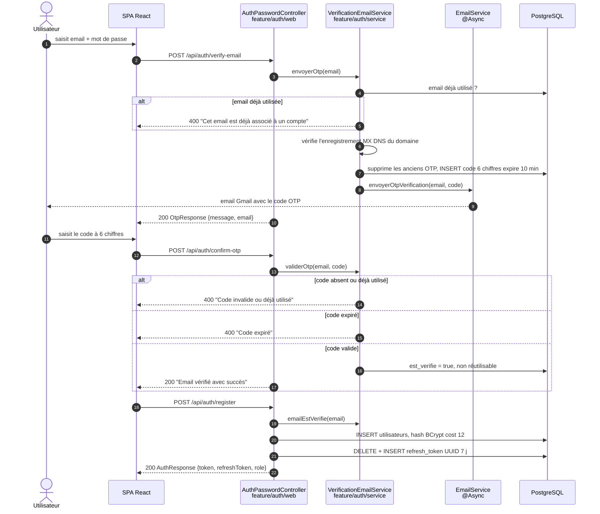

---

## 2. Login JWT, requête protégée, refresh, logout

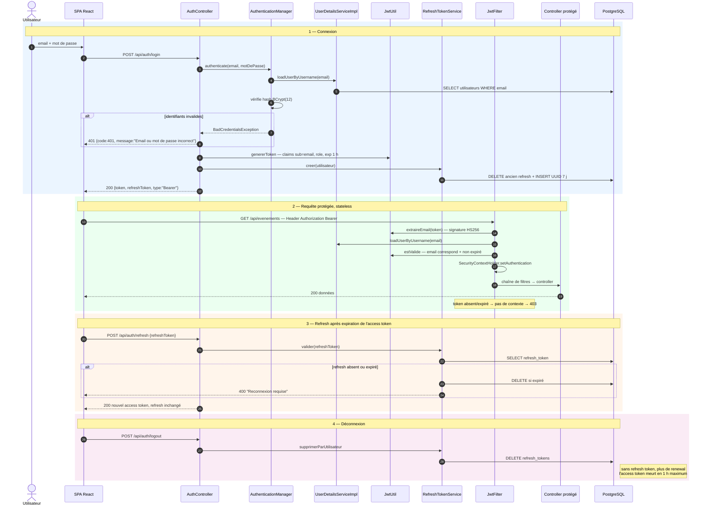

---

## 3. Entrée détectée — chaîne complète ESP-NOW → MQTT → BDD → STOMP

Le parcours réel d'une personne : capteur ultrason du **slave**, radio ESP-NOW,
master qui publie sur `seaside/entrees/{licence}` (uniquement si la licence est valide),
backend Spring, puis dashboard React.

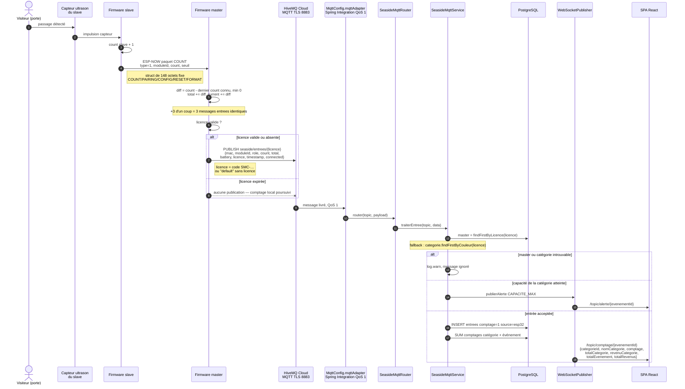

---

## 4. Télémétrie maître/esclave et alertes

Le master publie son état **toutes les 5 secondes** ; chaque paquet ESP-NOW COUNT
reçu d'un slave déclenche aussi une télémétrie slave.

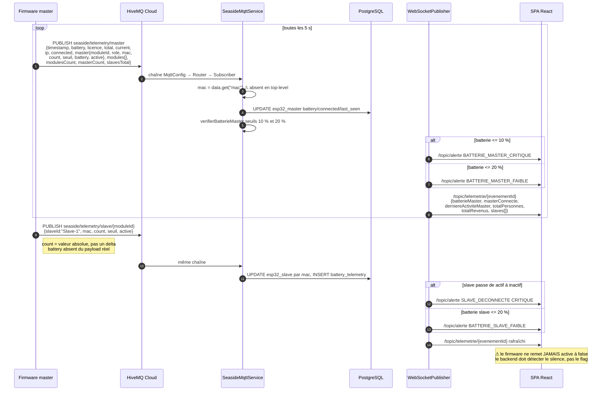

---

## 5. Commande distante vers un master (REST → MQTT → firmware)

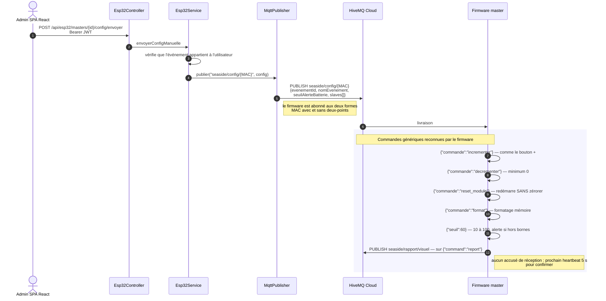

---

## 6. Appairage ESP-NOW master ↔ slave

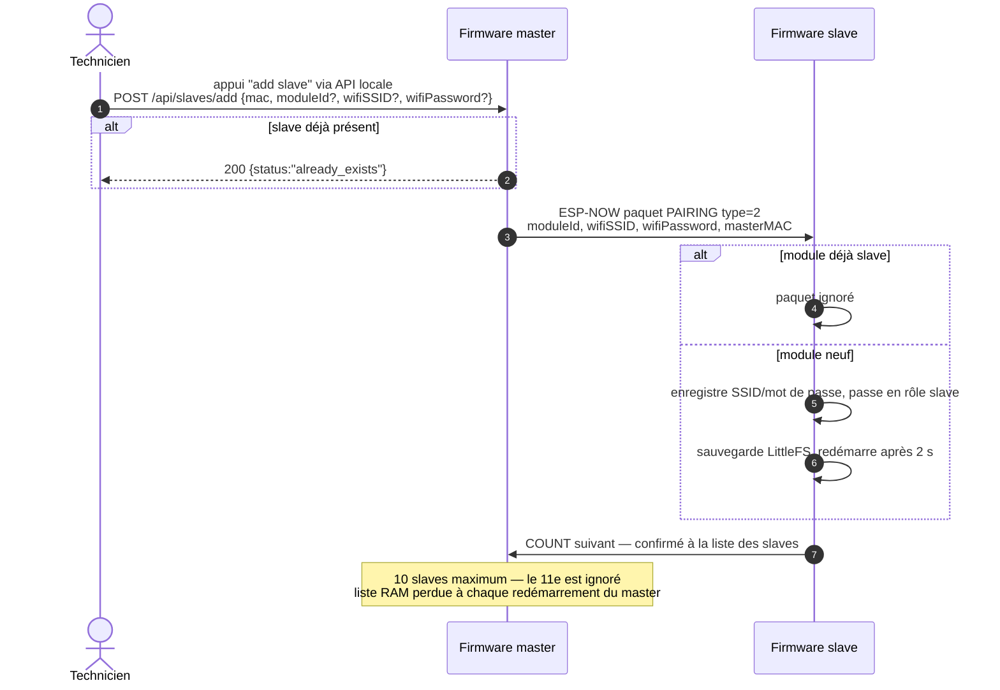

---

## 7. Mise en route réseau d'un master

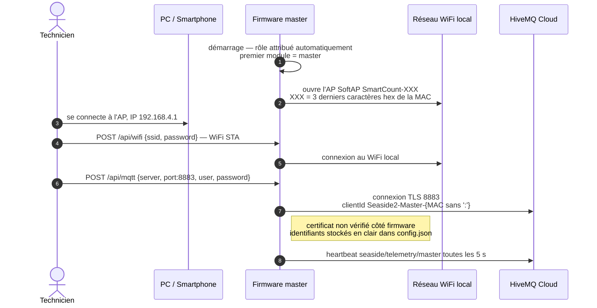

---

## 8. Licence : génération, injection, effet sur les entrées

Le firmware **auto-génère** ses licences (`POST /api/license/generate`) ou accepte
une licence externe (`POST /api/config/license`). Le backend `feature/licence`
(entité `License` existante, service à venir) devra s'aligner sur ce format.

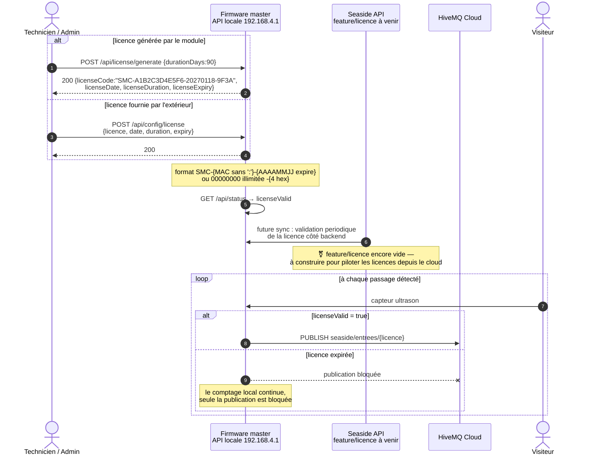

---

## 9. Annonce d'un esclave vers la passerelle

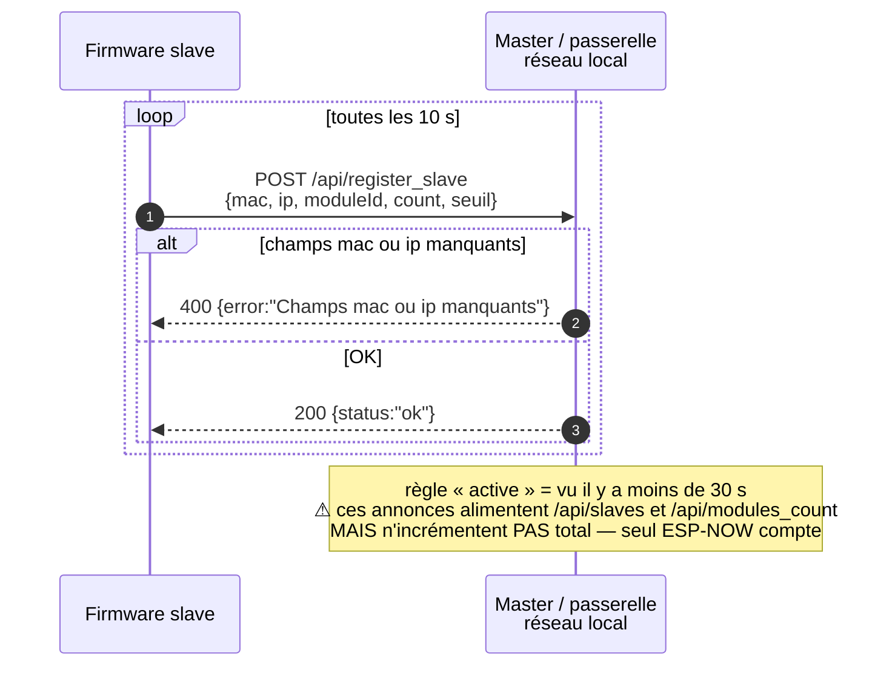

---

## 10. WebSocket local du master

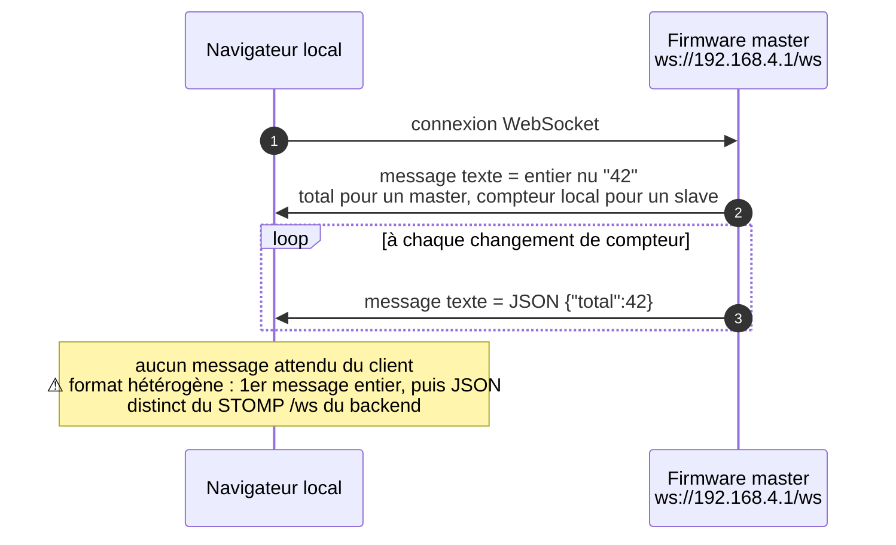

---

## 11. Session dashboard frontend (REST + STOMP)

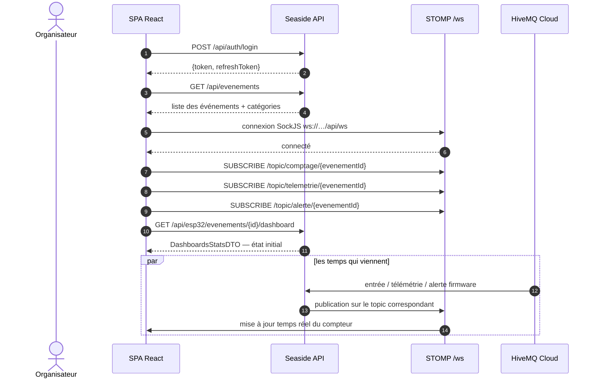

---

## 12. Onboarding organisateur — demande, validation admin, licence

Décisions D1/D2 (cf. `INSCRIPTION_ORGANISATEUR_RECOMMANDATIONS.md`) : inscription
libre en rôle `CLIENT` (**le rôle n'est plus lisible dans la requête** — correction P0),
demande d'activation envoyée à l'admin unique, activation seulement après validation +
paiement de l'abonnement **en espèces**, saisi par l'admin.

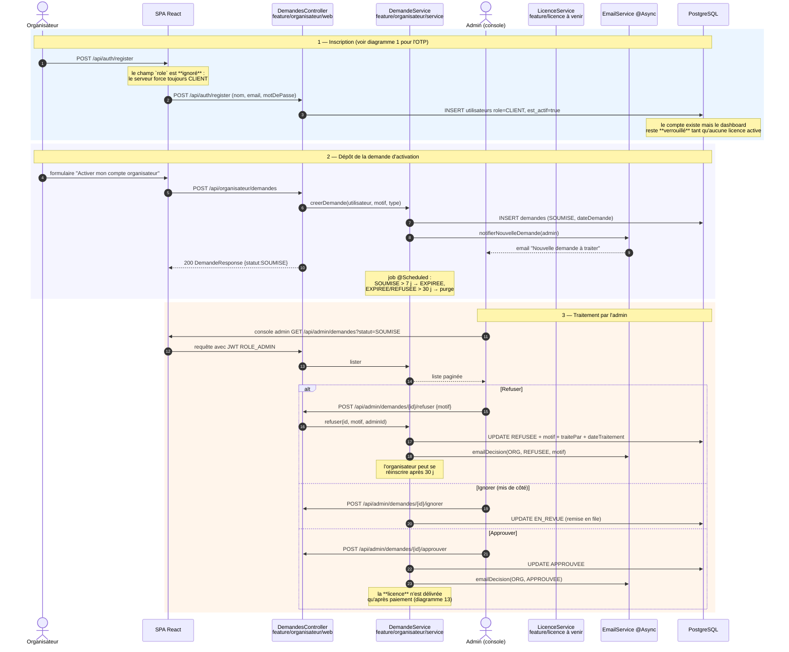

---

## 13. Abonnement en espèces, déblocage et renouvellement

Aucun paiement en ligne : l'organisateur paie **physiquement** l'admin, qui saisit le
paiement dans la console. Le statut d'abonnement pilote la licence, qui pilote le déblocage.

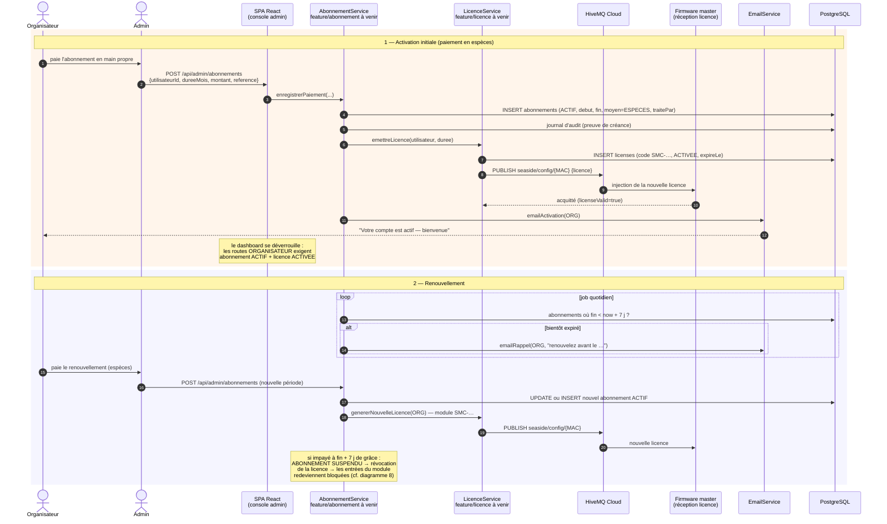

---

## 14. Publication d'événement — soumission et modération admin

Décision D4 : **aucun événement visible sans validation**. Workflow ajouté à l'entité
`Evenement` : `BROUILLON → SOUMISE → PUBLIEE ↔ MASQUEE`.

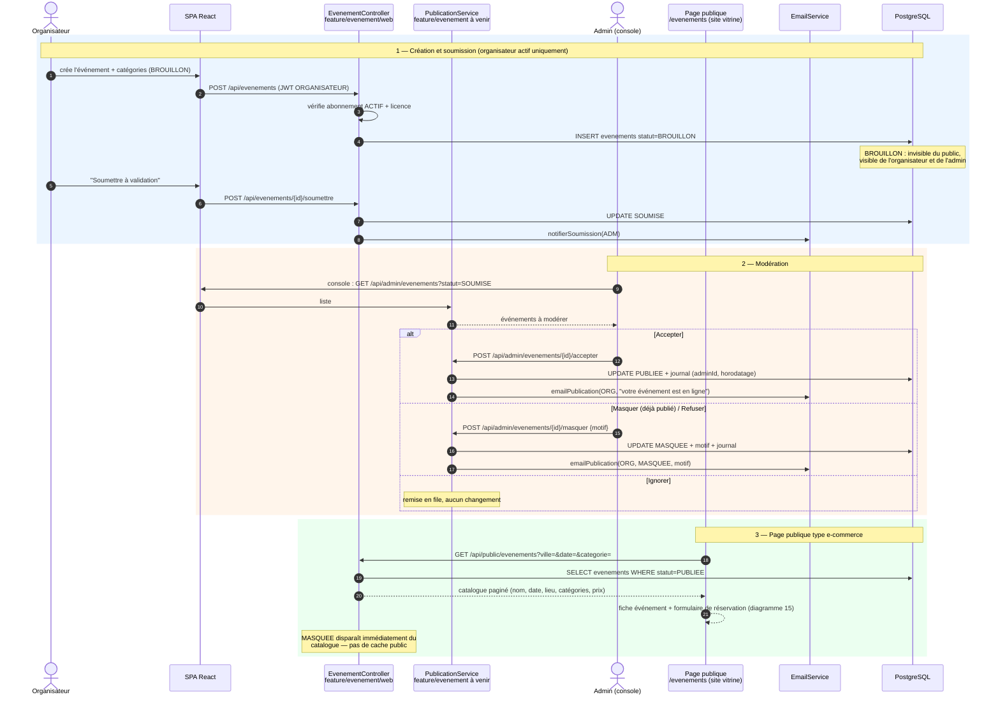

---

## 15. Réservation visiteur — intention non engageante puis paiement au guichet

Décision D5 : la réservation **n'engage la place qu'après paiement**. Comme il n'y a
pas de paiement en ligne, le paiement se fait **au guichet en espèces** ; l'organisateur
(ou son point de vente) confirme, et c'est là que la capacité est engagée.

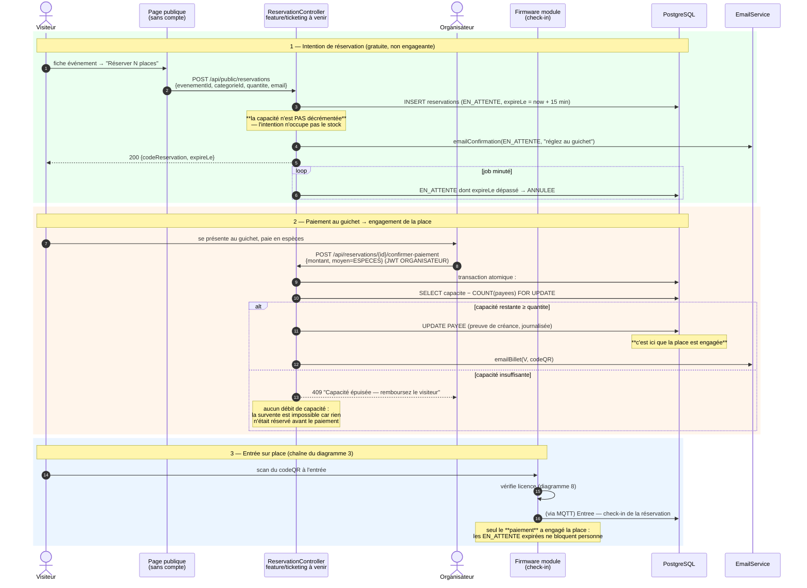

---

## Référence : topics et payloads firmware (rappeleur)

| Topic | Sens | Cadence | Payload résumé |
|---|---|---|---|
| `seaside/telemetry/master` | master → broker | 5 s | `{timestamp, battery, licence, total, current, ip, connected, master{…}, modules[], modulesCount, masterCount, slavesTotal}` |
| `seaside/entrees/{licence}` | master → broker | par passage | `{mac, moduleId, role, count, total, battery, licence, timestamp, connected}` — **mac = celle du master**, toujours |
| `seaside/telemetry/slave/{moduleId}` | master → broker | par paquet COUNT slave | `{slaveId:"Slave-1", mac, count, seuil, active}` — count absolu, **sans battery** |
| `seaside/alerte` | master → broker | sur événement | `{mac, moduleId, alerte:"Erreur configuration: seuil hors limites (150 cm)"}` |
| `seaside/rapport/visuel` | master → broker | sur commande | payload complet type `/api/status` étendu |
| `seaside/config/{MAC}` et `{MAC sans ':'}` | broker → master | à la demande | `{commande|command}` ou `{seuil}` |

Conventions firmware : `count` = compteur **local** ; `total` = master + différences slaves ;
`current` = personnes présentes ; `seuil` défaut 80 ; `timestamp` = **uptime en ms**, pas une date.

---

## ⚠ Conformité firmware ↔ backend — écarts constatés

Réponse à « est-ce que la doc firmware suffit pour le projet ? » : **presque** — le cœur MQTT
 correspond, mais **2 écarts bloquants** et 4 points de vigilance doivent être tranchés.

| # | Sujet | Firmware envoie… | Backend attend / fait… | Verdict |
|---|---|---|---|---|
| 1 | `mac` dans `telemetry/master` | pas de champ `mac` **en top-level** (il est dans `master{}` et `modules[]`) | `traiterTelemetrieMaster` fait `data.get("mac")` puis **return si null** | 🔴 **BLOQUANT** — la télémétrie master entière est rejetée. Soit le firmware ajoute `"mac"` top-level, soit le backend lit `data["master"]["mac"]` |
| 2 | Taille MQTT | PubSubClient limite à **256 octets**, le payload telemetry dépasse dès 1 slave | le backend s'attend à recevoir le heartbeat 5 s | 🔴 **BLOQUANT côté firmware** — les messages sont **jetés silencieusement** sans `MQTT_MAX_PACKET_SIZE` dans `platformio.ini` (le PDF lui-même le signale) |
| 3 | `battery` dans `telemetry/slave` | absent (et `battery` slave toujours 100 factice) | backend lit `battery` → null toléré, jamais mis à jour | 🟡 mineur — batterie slave inutilisable, le doc firmware le confirme |
| 4 | `active` slave | passe à `true` à la 1re réception, **jamais remis à false** | l'alerte `SLAVE_DECONNECTE` se déclenche sur `active=false` | 🟡 **l'alerte ne se déclenchera jamais** — le backend doit détecter l'absence de télémétrie (ex. > 30 s) |
| 5 | Champ du message d'alerte | `{mac, moduleId, alerte:"Erreur configuration: seuil hors limites (150 cm)"}` | backend lit `data.get("alerte")` | ✅ compatible — champ `alerte` confirmé dans la doc firmware |
| 6 | `default` sans licence | topic `seaside/entrees/default` | lookup `findFirstByLicence("default")`, fallback `findFirstByCouleur("default")` | 🟡 fragile — la catégorie ne peut pas avoir la couleur « default » ; définir la règle |
| 7 | Horodatage | `timestamp` = uptime ms depuis boot | backend utilise `LocalDateTime.now()` | ✅ sans effet, mais ne jamais interpréter comme une date |
| 8 | QoS | PubSubClient publie en QoS 0 par défaut | backend s'abonne en QoS 1 | ✅ le flux réel sera QoS 0 — acceptable, noter la perte possible |
| 9 | `seaside/rapport/visuel` | publié sur commande | abonnement `seaside/telemetry/#` et `entrees/#` : **non couvert** | ✅ volontaire — le rapport local n'est pas consommé par le backend |
| 10 | Licences | générées **par le module** via son API locale | `feature/licence` côté backend : entité seule, rien d'implémenté | 🔵 à arbitrer : qui émet les licences, le module ou le cloud ? |
